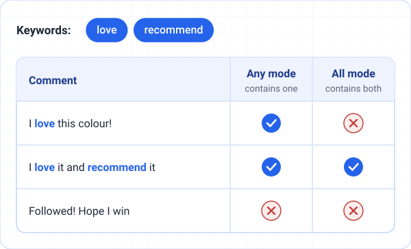

+++
title = 'Transparent Giveaways: How Pitchat Balances Fairness, Efficiency and User Experience'
description = 'How can a social media giveaway prove it is fair? We walk through Pitchat’s three-stage draw (sampling, filtering and a random pick) and explain the reasoning behind each design choice.'
date = 2025-09-08T08:08:07+08:00
draft = false
categories = ["Giveaway Tools"]
cover = { image = "cover.png", alt = "Isometric illustration of a prize wheel next to a checklist and a list of names, representing a transparent giveaway process" }
+++

When you run a giveaway on social media, participants want to know whether the draw is fair. In practice, though, a perfectly fair draw is hard to achieve: platform APIs impose limits, and much of the process usually happens out of sight.

[Pitchat](https://pitchat.co/app?r=blog) takes a different approach. Instead of promising "absolute fairness", we build trust through transparency and aim for a fair process. Every step of the draw runs in your browser, where you can watch it happen, and we explain how each step works so that you can understand it rather than take it on faith.

This article walks through Pitchat's three-stage draw: sampling comments into a candidate pool, filtering the pool, and picking winners at random. Along the way, we explain how we balance fairness, efficiency and user experience, the reasoning behind each design decision, and why transparency is worth more than promises.

## Why We Focus on Transparency

What is the first question that comes to mind when you think about a giveaway? Probably "Is it fair?" That is a reasonable question, but a perfectly fair draw runs into several practical problems.

### Why Perfect Fairness Is Hard to Achieve

Ideally, a draw would fetch every comment at once, filter out anyone who is not eligible, and pick winners at random from the rest. It sounds simple, but in practice it runs into three problems:

1. **Platform API limits**

    - Social media APIs limit how often they can be called and how much data each page returns
    - Comments cannot be fetched all at once; they have to be read page by page
    - The more comments a post has, the longer this takes

2. **Server-side processing**

    - If the draw runs on a server, users cannot see what happens
    - Users may wait a long time before they see any results
    - Users cannot verify that the draw was fair and simply have to trust the platform

3. **Gaps in how filters are implemented**
    - Each platform's API returns data in a different format
    - Filtering logic, such as keyword matching and mention counts, can get complicated
    - Edge cases are easy to overlook

Any of these can undermine a claim of perfect fairness, so we took a different approach.

### Our Solution: A Fair Process

Rather than chase an "absolute fairness" that cannot be fully achieved, we optimise across three dimensions:

| Dimension      | Our approach                                                      |
| -------------- | ----------------------------------------------------------------- |
| **Fairness**   | An open process and algorithm that users can understand and verify |
| **Efficiency** | A smart sampling strategy for handling large numbers of comments  |
| **Experience** | Real-time progress updates and clear filter settings               |

---

## How We Make the Process Transparent

We make the draw transparent in two ways, so you never have to trust us blindly.

### 1. The Draw Runs in Your Browser, in Plain Sight

**Every step of the draw runs in your browser.**

What does this mean?

- The draw does not rely on our servers to do any of the calculations
- You can follow its progress in real time: reading comments → filtering → drawing winners
- Anyone with technical knowledge can open the browser's developer tools and inspect the code
- There is no black box and nothing hidden on a server

What does this cost? Speed. We solve that with a careful sampling strategy.

### 2. We Explain How It Works

We don't just say "we are fair"; we explain exactly how we keep the draw fair.

This article is the first step in that commitment. In it, we:

- Explain why perfect fairness is hard to achieve
- Describe what each of the three stages does
- Explain how each filter works
- Show how we balance fairness, efficiency and user experience

This lets users without a technical background understand the whole draw instead of trusting it blindly.

---

## The Three Stages of a Draw (Using an [Instagram Giveaway](https://pitchat.co/app/instagram?r=blog) as an Example)

We split the draw into three distinct stages, each with its own goal and filters.

### Stage 1: Filter and Sample Comments While Reading Them

**Goal**: Read every comment from the Instagram API, applying the first set of filters and sampling as we go.

#### Sampling: Handling Large Volumes Fairly

Imagine an Instagram post with hundreds of thousands, or even millions, of comments. Besides the fact that they cannot all be fetched at once, two more problems arise:

- **Memory**: A browser cannot hold a million comments at the same time
- **Processing time**: Even if it could, processing a million records would take a long time

Our solution is an algorithm called **reservoir sampling**.

**How does it work?**

Put simply, we sample fairly as we read. (Throughout this section, "comments" means valid comments, defined below.)

- The first 1,000 valid comments are all kept
- From the 1,001st onwards, each valid comment has a chance of entering the candidate pool, replacing one of the comments already in it

**Why is this fair?**

The algorithm is mathematically proven to guarantee one key property: **once every valid comment has been read, each one has exactly the same probability of ending up in the candidate pool**.

For example:

- Suppose the API returns 50,000 comments, and 10,000 of them are valid after filtering
- Whether a valid comment is the 1st, the 5,000th or the 10,000th, its chance of ending up in the pool is 1,000 ÷ 10,000 = 10%
- The 40,000 comments that were filtered out have a 0% chance of winning

If there are 1 million valid comments, each one has a 1,000 ÷ 1,000,000 = 0.1% chance of being kept.

This ensures that **among valid comments**, when someone commented makes no difference.

**Why is it a good fit here?**

1. **Fairness**: Every valid comment has the same chance of being selected, regardless of when it was posted
2. **Memory efficiency**: No matter how many comments a post has, we only keep around 1,000 in memory
3. **Reasonable speed**: We avoid processing millions of records, so results arrive in a reasonable time

It strikes the right balance between perfect fairness (processing every comment) and speed (drawing only a small sample).

**Key concept: what is a valid comment?**

Before going into the details, it helps to define two terms:

- **Raw comments**: Every comment returned by the Instagram API
- **Valid comments**: Comments that pass all of the Stage 1 filters (excluding yourself, duplicate comments and the time range)

For example, the API might return 50,000 raw comments, of which only 10,000 are valid after Stage 1. The other 40,000 (your own comments, duplicates and comments outside the time range) never enter the sampling or the draw.

**Why does this distinction matter?** Because sampling only takes place among valid comments, which guarantees that every valid comment has the same chance of being selected.

**What happens in this stage**:

1. Request the next page of comments from the Instagram API
2. Apply the real-time filters to each comment (detailed below)
3. Sample the comments that pass
4. Repeat until every comment has been read

**The three filters in this stage**:

#### Exclude Yourself

- **Purpose**: Ensures the host cannot win their own giveaway
- **How it works**: Compares each commenter's account with the host's account
- **Why it matters**: Keeps the draw impartial

#### Duplicate Comments

- **Purpose**: Gives each participant one chance to win, based on their first comment
- **How it works**: Remembers every username it has seen and keeps only each user's first comment
- **Why it matters**: Stops people from improving their odds by commenting multiple times

#### Time Range

- **Purpose**: Only counts comments posted within a specific period
- **How it works**: Compares each comment's timestamp with the start and end times you set
- **Why it matters**: Ensures that only entries made during the announced giveaway period are counted

**Resuming progress**:
If you close your browser during a draw, Pitchat remembers where it stopped, so you can pick up from there next time without reading every comment again.

---

### Stage 2: Apply Filters

**Goal**: Apply more detailed filters to the comments read in Stage 1.

**What happens in this stage**:

1. Check each candidate comment from Stage 1
2. Apply the filters that need a comment's full content
3. Confirm that enough candidates remain for the draw

**The four filters in this stage**:

#### Blocklist

- **Purpose**: Excludes specific users, such as people who are not eligible to take part
- **How it works**: Removes any comment whose author is on the blocklist
- **Example**: Exclude users outside your region, or brand accounts

#### Keywords

- **Purpose**: Only includes comments that contain specific keywords
- **How it works**: Checks whether a comment contains the keywords you specify
- **Two modes**:
    - **"Any" mode**: A comment needs to contain at least one of the keywords (OR logic)
    - **"All" mode**: A comment must contain every keyword (AND logic)
- **Examples**:
    - Keywords "love" and "recommend" in "Any" mode → a comment containing either word qualifies
    - Keywords "I love" and "this product" in "All" mode → a comment must contain both phrases

#### Mentions

- **Purpose**: Ensures participants @mention enough people in their comment
- **How it works**: Counts the @mentions in each comment
- **Example**: With "at least 2" set, a comment must tag at least two people

#### Multiple Wins

- **Purpose**: Controls whether the same person can win more than one prize
- **How it works**: Determines which algorithm Stage 3 uses (explained below)
- **Two modes**:
    - **Allowed**: The same person can win several prizes
    - **Not allowed**: Each person can win at most one prize

**Checking the number of candidates**:
Before moving on to Stage 3, the system checks that there are enough candidates for the number of prizes. For example, if you want 10 winners but only 5 candidates qualify, the system will let you know and won't run the draw.

---

### Stage 3: Draw the Winners

**Goal**: Pick winners at random from the qualifying candidates.

**What happens in this stage**:

1. Choose the algorithm based on the "Multiple Wins" setting
2. Pick the specified number of winners at random
3. Show you the results

**Two ways to draw**:

#### Mode A: Multiple Wins Allowed

**When multiple wins are allowed**, the process is simple:

- For each prize, one person is picked at random from the candidate pool
- That person stays in the pool and could be picked again for the next prize
- It is simple and fast

When to use it:

- You don't mind if someone wins more than once
- You want to give active participants as many chances to win as possible

#### Mode B: Multiple Wins Not Allowed

**When multiple wins are not allowed**, the process is more involved but spreads prizes more fairly:

1. All candidates are put into a random order (a "shuffle")
2. Winners are taken from that order one by one: first, second, third and so on
3. Each winner is marked as having won and is not considered again

When to use it:

- You have a limited number of prizes and want more people to have a chance of winning

---

## Why We Designed It This Way

### 1. Running in the Browser Makes the Draw Transparent and Verifiable

- **Transparent**: There is no server-side black box, so users can understand the whole process
- **Verifiable**: Developers can review the code to confirm nothing is being manipulated
- **Real-time feedback**: Users can follow the progress instead of waiting with no idea what is happening

### 2. Three Stages Make It Efficient

- **Stage 1**: Reading and filtering happen together, which reduces how much data needs to be kept
- **Stage 2**: Filters run only on the candidate pool, which reduces the amount of computation
- **Stage 3**: Winners are drawn directly from the final candidates, which keeps the logic clear

Splitting the work into stages lets the system handle large volumes of data while staying fast.

### 3. Sampling Balances Fairness and Efficiency

Reservoir sampling ensures that:

- Only 1,000 comments need to be kept, even when a post has millions
- Every comment has exactly the same chance of being selected
- Processing time drops from hours to minutes, or even seconds

### 4. Layered Filters Cover a Wide Range of Needs

The seven filters can be combined in different ways:

- A simple giveaway: turn on just "Exclude Yourself" and "Duplicate Comments"
- A more complex giveaway: combine filters such as "Keywords", "Mentions" and "Time Range"
- Flexibility: every type of giveaway is supported

### 5. Caching Speeds Things Up

Caching saves you from repeating work in two situations:

**When you change filter or prize settings**: If you only change settings for Stage 2 or Stage 3, the draw reuses the cached results instead of reading the comments again.

**When something interrupts the draw**: If your connection drops or your browser closes unexpectedly, the system keeps the completed Stage 1 results. When you come back, you can continue straight from filtering and the draw, without spending time reading the comments again.

**How it works**: The system caches the Stage 1 candidate pool for 30 minutes. If you change the post or any Stage 1 setting (Exclude Yourself, Duplicate Comments or Time Range), it fetches the latest comments again.

---

## Conclusion: The Power of Transparency

In any system that involves random selection, transparency is the foundation of trust. That trust comes not from a platform saying "we are fair", but from users being able to understand and verify the whole process.

Our commitment to transparency means that we:

- Don't claim "absolute fairness"; instead, we explain how we achieve a fair process
- Show the complete process and logic so that anyone can understand it
- Let users see what is happening in real time, with no hidden server-side black box

We believe **transparency is worth more than promises**. Once you understand every step of the process, from reading comments through the API to the Stage 1 filters, reservoir sampling and the final random draw, you don't need to trust us blindly. You can trust the system because you understand it.

That is the core idea behind giveaways on Pitchat.

---

Pitchat offers giveaway tools for **[Instagram](https://pitchat.co/app/instagram?r=blog)**, **[Threads](https://pitchat.co/app/threads?r=blog)**, **[Facebook](https://pitchat.co/app/facebook?r=blog)**, **[YouTube](https://pitchat.co/app/youtube?r=blog)** and [other platforms](https://pitchat.co/app/giveaway?r=blog), covering the most popular social networks.

Ready to run your next giveaway? Head to [Pitchat](https://pitchat.co/app?r=blog) and make it faster and easier.
