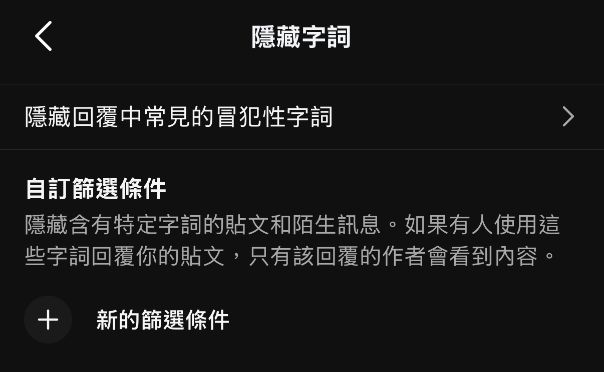
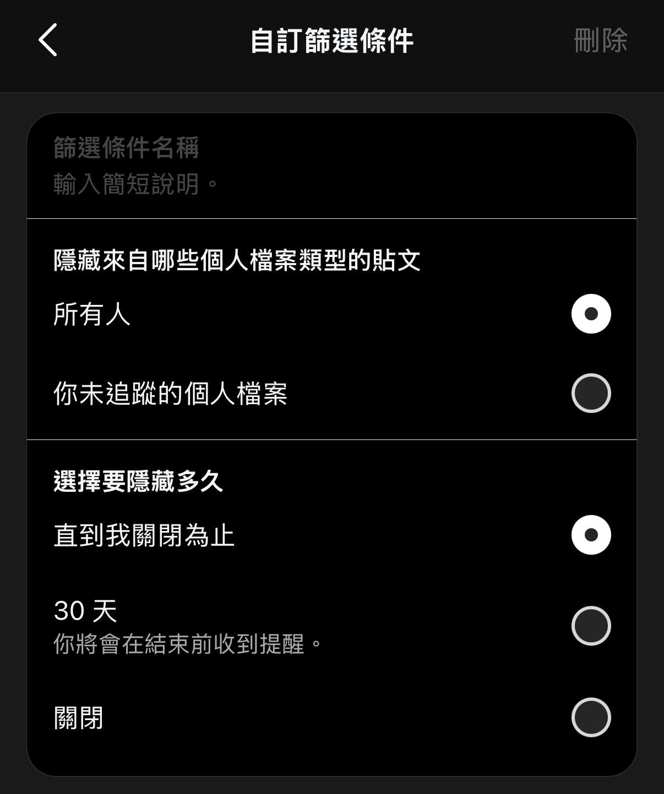
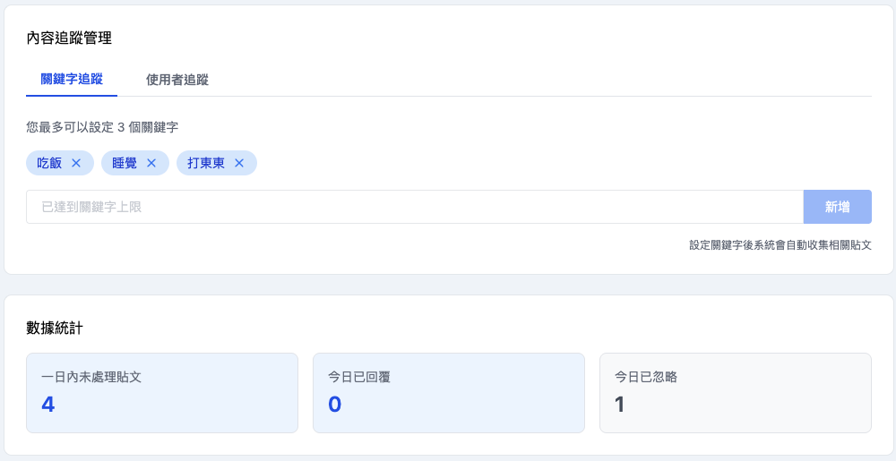
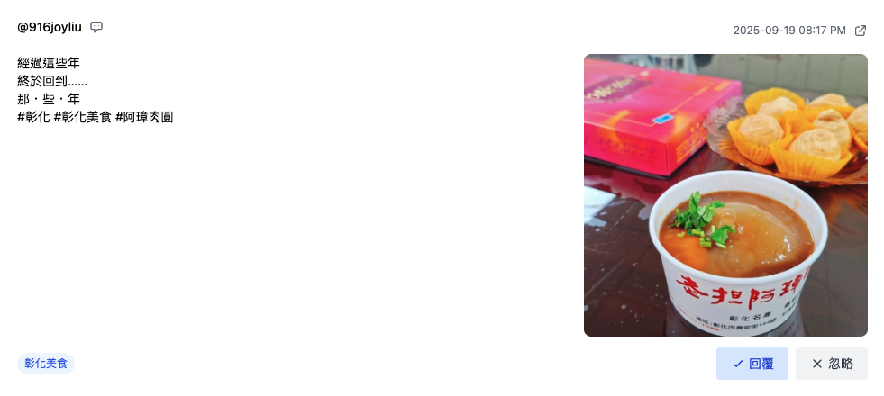

+++
title = '脆 Threads 不想看的內容怎麼隱藏？隱藏字詞、追蹤中、自訂動態教學'
description = 'Threads 動態一直出現不想看的內容？本文整理隱藏字詞、「沒興趣」、追蹤中與自訂動態消息的設定方式，說明 Dear Algo 在台灣的現況，以及需要固定追蹤關鍵字時可用的工具。'
date = 2025-09-05T18:08:07+08:00
lastmod = 2026-11-25T20:40:00+08:00
draft = false
categories = ["Threads"]
tags = ["Threads", "社群媒體", "演算法"]
cover = { image = "cover.webp", alt = "插圖：在 Threads 隱藏不想看的貼文，漏斗擋下迷因和連結，只留下攝影、棒球、咖啡等想看的主題" }
+++
想讓 Threads（脆）少出現不想看的內容、多出現想看的，最直接的方法是用 App 內建的設定：用「隱藏字詞」過濾含特定文字的貼文、對不想看的貼文選「沒興趣」、切到「追蹤中」只看你追蹤的人，或用關鍵字和帳號建立「自訂動態消息」。這些功能台灣都能用，不需要另外安裝工具。

會一直看到不想看的內容，是因為首頁動態不是依時間排列，而是由系統預測你可能感興趣的貼文，把追蹤帳號和推薦的陌生帳號貼文混在一起排序。排序怎麼運作，可以參考 **[Threads 的演算法]()** 這篇的整理。

至於「親愛的脆，我想看 XXX」這種直接對演算法喊話的方式，Meta 確實推出了類似的功能 Dear Algo，但截至 2026 年 11 月，台灣還不在推出地區。以下依「少看不想看的」「多看想看的」整理做法，最後介紹需要每天追蹤特定關鍵字或帳號時，怎麼做比較有效率。

## 少看不想看的內容：3 個內建設定

### 隱藏字詞：過濾含特定文字的貼文

依 [Instagram 說明中心](https://help.instagram.com/171172755868764)的說明，把字詞、片語或表情符號加入隱藏字詞清單後，含有這些內容的貼文會從動態中隱藏，但仍會出現在搜尋結果和別人的個人檔案中。舉例來說，如果不想看到蝦皮分銷連結的貼文，可以把「s.shopee.」設為隱藏字詞，隱藏包含蝦皮分銷連結的相關貼文。

設定方式：

1. 到自己的個人頁面，點右上角的「兩條橫槓」進入設定
2. 點「內容偏好設定」→「隱藏字詞」
3. 點「新的篩選條件」，在「篩選條件名稱」輸入一個自己認得的簡短說明，再點「新增字詞」輸入想隱藏的字詞，多個字詞用半形逗號分隔
4. 選擇要隱藏哪些帳號的貼文（「所有人」或「你未追蹤的個人檔案」），以及要隱藏多久（「直到我關閉為止」「30 天」或「關閉」），最後點「儲存」

只想過濾陌生帳號、不想連朋友的貼文一起擋掉，就選「你未追蹤的個人檔案」。

另外，2025 年 6 月起，Threads 的隱藏字詞改為和 Instagram 分開管理（[TechCrunch 報導](https://techcrunch.com/2025/06/26/threads-now-lets-you-manage-hidden-words-separately-from-instagram-set-time-limits/)），在 Threads 設定的字詞不會影響 Instagram。篩選條件也可以只隱藏 30 天（結束前會收到提醒），想暫時避開還沒追完的影集、比賽結果時很好用。

同一個「內容偏好設定」頁面裡，還有「已靜音」的帳號名單，以及「敏感內容」「政治內容」的推薦設定，不想看到太多這類話題時也可以進去調整。

### 對不想看的貼文選「沒興趣」

在動態中遇到不想看的貼文，可以點貼文右上角的「⋯」，選「沒興趣」把它隱藏。依 [Meta 透明度中心](https://transparency.meta.com/features/explaining-ranking/ig-threads-feed/)的說明，隱藏貼文時系統也會減少顯示類似的內容，所以效果不只是這一則。

如果是特定帳號一直出現，可以直接靜音或取消追蹤；靜音過的帳號可以在「內容偏好設定」→「已靜音」查看。

隱藏字詞和「沒興趣」的差別在於：隱藏字詞是依文字精準過濾，「沒興趣」則是讓系統學習你不想看哪一類內容。兩者可以搭配使用。

### 檢舉違規內容

遇到詐騙、仇恨等違反社群守則的貼文，用檢舉而不是只隱藏。Meta 表示，使用者檢舉後，系統也會減少顯示類似的內容。

## 多看想看的內容：追蹤中、自訂動態與主動互動

### 切到「追蹤中」：只看你追蹤的人，依時間排序

打開 Threads App 預設看到的首頁動態（網頁版標示為「為你推薦」）會混合追蹤帳號和推薦內容。切換到「追蹤中」，就只會看到你追蹤的帳號，依發布時間由新到舊排列，不會出現推薦的陌生帳號貼文。

「追蹤中」好不好用，取決於你追蹤了誰。追蹤的帳號一多，想看的貼文還是會被大量貼文淹沒，所以建議定期整理追蹤名單，只留下真正想看的創作者。

### 自訂動態消息：用關鍵字或帳號建立專屬動態

想固定看某個主題，例如棒球、攝影或某個產業的討論，可以建立自訂動態消息：

1. 在首頁左上角點「兩條橫槓」
2. 點上方的「+」
3. 點「新增個人檔案或主題」，輸入關鍵字或想關注的帳號
4. 點右上角的「完成」，再點「建立動態消息」

也可以先搜尋關鍵字，再從搜尋結果頁右上角的「⋯」建立。關鍵字動態可以選擇依熱門或最新排序，想看即時討論就選最新。建立好的動態還可以設為公開，分享給其他人使用。

### 主動搜尋、和想看的內容互動

Meta 公開的排序訊號包括你過去一週的互動，以及你最近 15 分鐘按讚過的貼文。所以主動搜尋想看的主題，對喜歡的貼文按讚、回覆，系統參考到的訊號就會偏向這些內容。這不是保證有效的開關，但比被動地滑更有機會讓動態往你想要的方向調整。

## 「親愛的脆」有用嗎？Dear Algo 與 Your Algo

很多人在脆上發過「親愛的脆，我想看 XXX」，Meta 在 2026 年真的推出了類似的功能：

- **Dear Algo**（2026 年 2 月）：在公開貼文中輸入「Dear Algo」，接著寫想多看或少看的內容，系統會調整你接下來 3 天的動態；別人也可以轉發你的請求套用到自己的動態。
- **Your Algo**（2026 年 6 月）：私人版本，在設定中指定想多看或少看的主題，效果可選 1 天、3 天或 7 天。

不過截至 2026 年 11 月，[Dear Algo](https://about.fb.com/news/2026/02/threads-dear-algo/) 首批推出地區是美國、英國、澳洲、紐西蘭，[Your Algo](https://about.fb.com/news/2026/06/meta-launching-new-features-500-million-monthly-threads-users/) 首批是美國、加拿大、英國、澳洲、紐西蘭，都不包含台灣。在台灣發「親愛的脆」貼文，目前沒有官方說明會有作用；想調整動態，還是以上面的內建設定為主。

## 需要每天追蹤特定關鍵字或帳號？用 Pitchat 貼文探索

品牌小編、做市場觀察的人，常需要每天看過特定關鍵字或幾位創作者的新貼文，再決定要不要回覆。自訂動態消息可以把內容集中起來，但哪些看過、哪些回了，只能自己記。Pitchat 的「貼文探索」就是為這種情境設計的：

1. 進入 Pitchat「貼文探索」，用 Threads 帳號透過 Meta 官方授權流程登入
2. 在「內容追蹤管理」選擇「關鍵字追蹤」（不分方案，最多 3 個關鍵字），或「使用者追蹤」指定創作者
3. 系統會定期透過 Threads 官方 API 自動收集新貼文，只顯示 72 小時內發布的貼文

每則貼文都可以標記處理狀態：按「回覆」會在新分頁開啟該則 Threads 貼文並標記為已回覆（Pitchat 不會替你發出回覆），不需要處理的按「忽略」；一次看不完，可以按「我累了」把未處理的貼文全部標記。上方的「數據統計」會顯示一日內未處理貼文、今日已回覆和今日已忽略的數量。

使用前請注意：使用者追蹤免費方案最多 3 位、付費方案最多 10 位，方案內容依實際提供為準；只能追蹤粉絲超過 1,000 的帳號；收集到的貼文取決於 Threads 官方 API，不一定涵蓋所有相關貼文。

| | 自訂動態消息 | Pitchat 貼文探索 |
|---|---|---|
| 在哪裡使用 | Threads App、網頁版 | Pitchat 網站 |
| 追蹤對象 | 關鍵字、主題、帳號 | 最多 3 個關鍵字（不分方案）；創作者依方案（免費 3 位） |
| 顯示範圍 | 依熱門或最新排序 | 只顯示 72 小時內的貼文 |
| 處理紀錄 | 沒有 | 標記已回覆、已忽略，查看每日統計 |
| 適合 | 日常瀏覽特定主題 | 需要逐則處理的工作情境 |

## 常見問題

### Threads 可以重設推薦內容嗎？

我們在 Threads 的設定中沒有找到這個功能（Instagram 有「重設推薦內容」）。想調整首頁動態，可以用「沒興趣」、隱藏字詞、「追蹤中」和自訂動態消息。

### 隱藏字詞會把搜尋結果裡的貼文也藏起來嗎？

不會。依 Instagram 說明中心，含有隱藏字詞的貼文只會從動態中隱藏，搜尋結果和別人的個人檔案仍看得到。

### 在 Threads 設定的隱藏字詞會套用到 Instagram 嗎？

不會。2025 年 6 月起，Threads 的隱藏字詞和 Instagram 分開管理，兩邊要各自設定。

---

需要每天追蹤特定關鍵字或創作者的新貼文？用 [Pitchat 貼文探索](https://pitchat.co/threads/explore)集中查看，逐則標記已回覆或已忽略（用 Threads 帳號登入後即可設定）。

> 延伸閱讀：剛開始使用 Threads？可以先看 [Threads 是什麼？脆的特色與使用方式]()。
