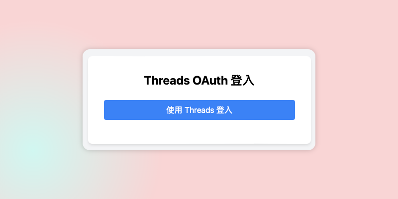
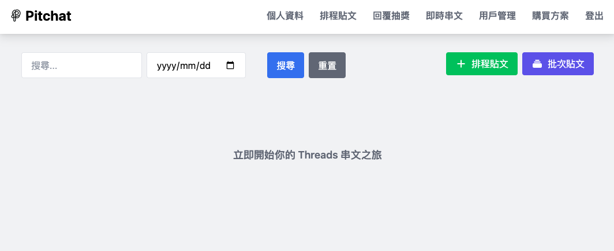
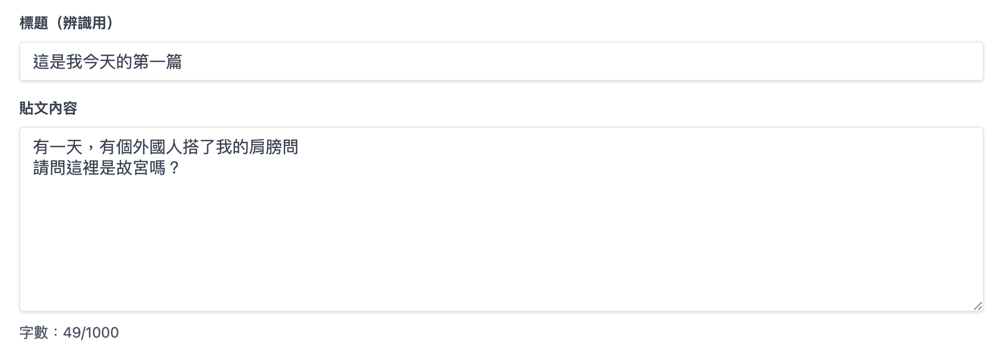
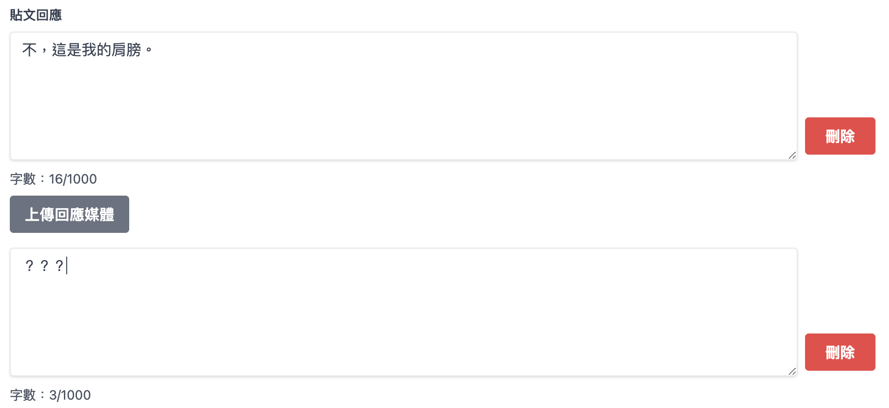
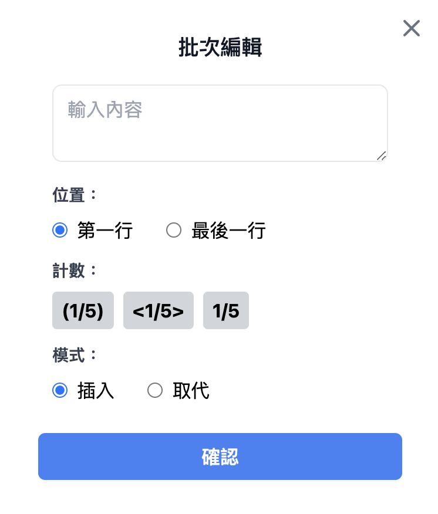
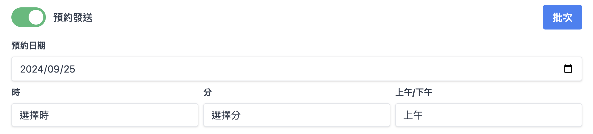

+++
title = 'Threads（脆）排定發文教學：預約貼文發布時間的完整步驟'
description = 'Threads（脆）怎麼排定發文、預約貼文的發布時間？本文一步步示範用 Pitchat 設定預約發文：登入平台、撰寫貼文、上傳媒體、選擇日期與時間，讓貼文在你設定的時段自動發布。'
date = 2024-09-25T07:07:07+08:00
draft = false
categories = ["Threads"]
tags = ["Threads", "發文工具"]
cover = { image = "post-editor.png", alt = "Pitchat 預約發文編輯畫面截圖：輸入貼文內容、上傳媒體，並設定預約發送的日期與時間" }
+++
你是否也在為 Threads（在台灣暱稱為「脆」）缺少排程發文功能而苦惱？別擔心，本文將為你揭示如何輕鬆實現 Threads 排程發文，讓你的社群經營更上一層樓！

## 為什麼需要 Threads（脆）排程發文？

在快節奏的社群媒體時代，精準的發文時間可以顯著提升貼文觸及率和互動度。雖然 Threads 創辦人馬克·祖克柏曾[承諾開發排程發文功能](https://www.threads.net/@zuck/post/C-srcchPpp7)，但截至 2024 年 9 月 25 日，官方仍未推出此功能。幸運的是，我們找到了完美的解決方案！

## Threads（脆）排程發文步驟指南

### 步驟一：登入 Pitchat 平台

1. 訪問 [Pitchat 官網的 Threads 排定發文頁面](https://pitchat.co/scheduled-threads)。
2. 使用你的 Threads（脆）帳號授權登入。

> 新手小提醒：需要詳細的註冊教學嗎？請查看這篇[Pitchat 註冊指南](https://pitchat.co/blog/posts/how-to-register-pithcat/)。

### 步驟二：進入排程貼文功能

1. 在 Pitchat 平台選單中，找到並點選「排程貼文」。

2. 點擊醒目的「＋排程貼文」按鈕。

### 步驟三：打造吸睛貼文內容

1. 精心撰寫你的貼文標題和內容，記得加入適當的關鍵字和話題標籤。

2. 上傳高質量的圖片或吸引眼球的短影音，提升貼文的視覺吸引力。

3. 善用回應功能，為長文章增添層次感和互動性。

> 專業小技巧：Pitchat 特別為長文章創作者提供了批次編輯功能，讓你的內容管理更加高效！

### 步驟四：智能設定排程時間

1. 根據你的目標受眾活躍時間，精準選擇貼文發布的最佳日期和時間。
2. 注意：如果想即刻發文，只需關閉預約狀態即可。

最後偷偷說設定完排程發文後，還可以設定LINE通知你排程是否有依照預期的時間發出喔。

## Threads（脆）排程發文的優勢

1. **時間管理**：提前安排貼文，釋放寶貴時間專注於內容創作。
2. **一致性**：保持穩定的發文頻率，提升粉絲黏著度。
3. **最佳時機**：針對不同時區的粉絲，在最佳時間點發布內容。
4. **內容品質**：有更多時間打磨內容，確保每篇貼文都達到最高水準。
5. **數據分析**：通過觀察不同時間發布的貼文表現，優化你的內容策略。

> 延伸閱讀：排定的貼文也可以[同步發布到 Instagram 與 Facebook]()，或搭配[關鍵字自動回覆]()，在貼文發布後自動回應留言。

## 掌握 Threads（脆）排程發文，成為社群達人

透過 Pitchat 平台，你現在可以輕鬆實現 Threads（脆）排程發文的夢想。無論你是努力經營個人品牌的創作者，還是管理企業社群的專業人士，這個強大的工具都能幫助你更有策略地規劃和發布內容，大幅提升你在 Threads 平台上的影響力。

立即開始使用 Pitchat 進行 Threads（脆）排程發文，讓你的社群經營更上一層樓！掌握這個技巧，你將成為 Threads 平台上的佼佼者，吸引更多粉絲，創造更大的社群價值。

別再等待了，現在就開始你的 Threads（脆）排程發文之旅，讓你的內容在最恰當的時機綻放光彩！