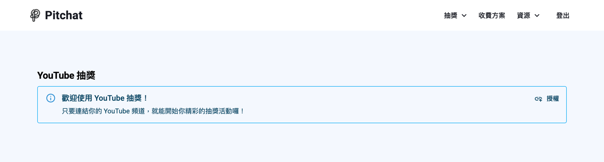
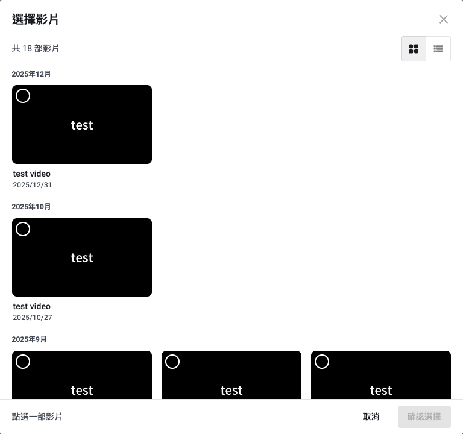
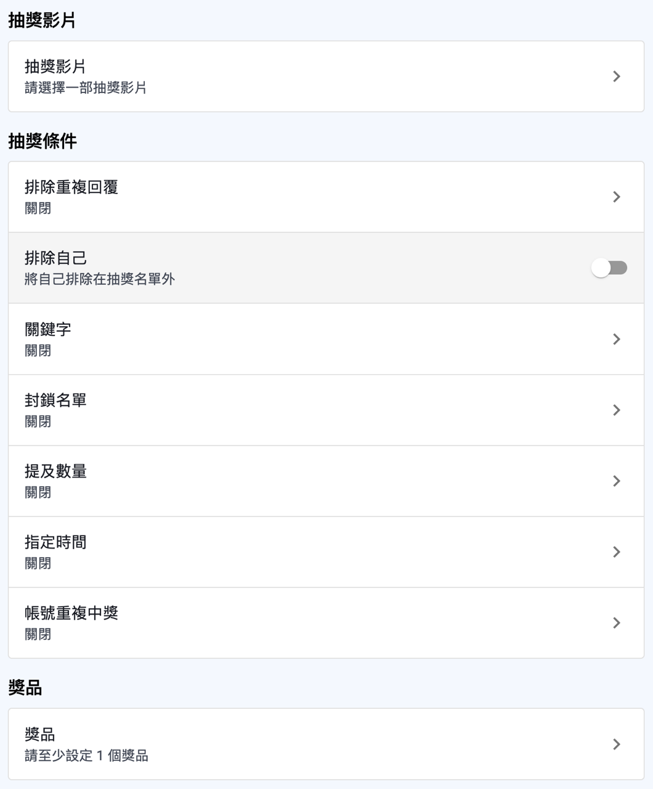
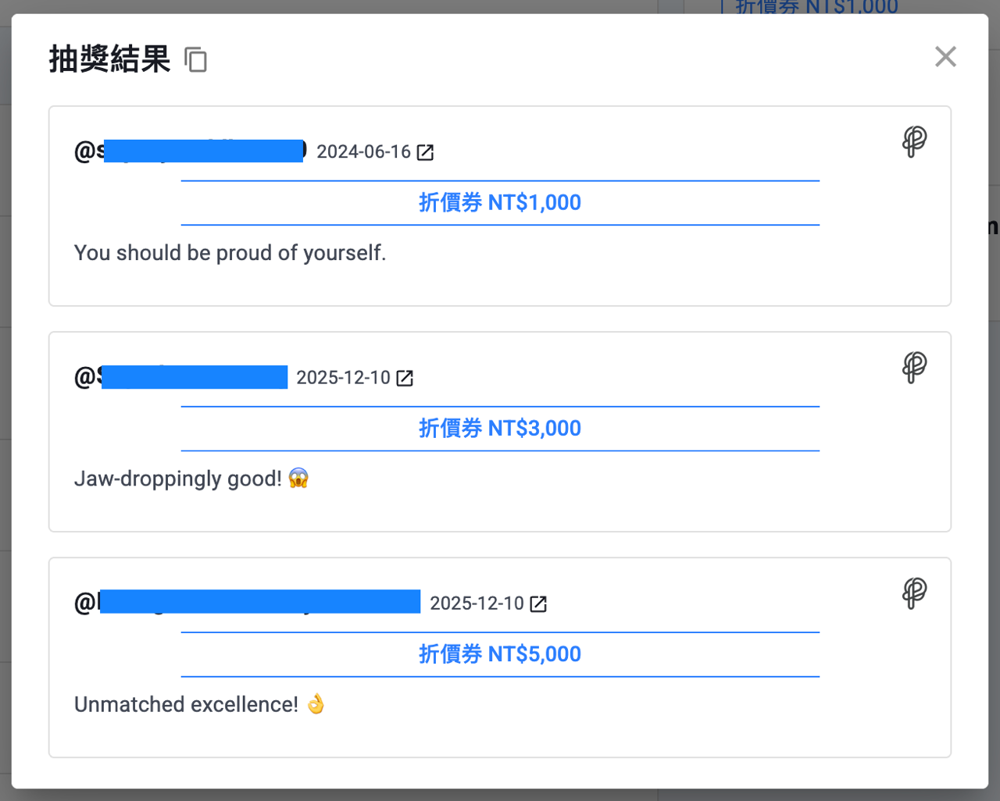

+++
title = 'YouTube 留言抽獎怎麼辦？規則設計、公平開獎到公布名單一次看懂'
description = '想在 YouTube 影片辦留言抽獎？本文說明活動規則怎麼訂、哪些條件能交給系統篩選、直播與訂閱驗證這些目前做不到的情況怎麼處理，以及開獎後如何公布名單，讓觀眾信服結果。'
date = 2025-09-07T08:08:07+08:00
lastmod = 2026-11-25T12:00:00+08:00
draft = false
categories = ["抽獎工具"]
cover = { image = "cover.webp", alt = "插圖：影片下方的留言經過勾選篩選，整理成一張得獎名單，示意 YouTube 留言抽獎流程" }
+++

在 YouTube 辦留言抽獎，流程可以拆成五步：在影片或說明欄公告規則、讓觀眾在活動期間留言、依規則篩出有效留言、從中隨機抽出得獎者，最後把名單公布在置頂留言。最容易引發爭議的，是中間「依規則篩選」和「公平抽出」這兩步。

留言一多，人工很難逐則看完。YouTube 預設把熱門留言排在最上面，同一個人留了好幾次、活動截止後才留的留言也混在一起。只要漏看一則，或前後認定的標準不一致，就很難向觀眾說明結果是怎麼來的。

這篇整理辦 YouTube 抽獎前要先確認的官方規範、規則怎麼訂才能逐條檢查、哪些條件目前無法用工具確認，以及開獎後怎麼公布名單和聯絡得獎者，讓每一場抽獎都說得清楚。

## 辦抽獎前，先看 YouTube 官方的比賽政策

YouTube 說明中心有一份「YouTube 比賽政策與規範」，適用於所有在 YouTube 上舉辦、或使用 YouTube 進行的比賽與抽獎。幾個和留言抽獎直接相關的重點：

- **主辦者自行負責**：整個活動由頻道主負責，並且要遵守當地法規；政策也提醒主辦者確認當地與抽獎相關的法規。
- **參加必須免費**：不能要求觀眾付費才能參加。
- **要有正式規則**：規則要連到 YouTube 社群規範，並說明違規的參加者會被取消資格。規則裡要聲明 YouTube 不是活動贊助者、請參加者免除 YouTube 的責任，也要說明如何使用參加者的個人資料。
- **不能操弄數據、不能暗示 YouTube 背書**：不得操弄觀看、按讚、訂閱等數據，也不能透過廣告單元辦活動。

另外，YouTube 的垃圾內容政策把「以獎勵換取按讚、觀看或訂閱」列為不當的互動操弄；但單純請觀眾按讚、留言、訂閱是允許的。所以在把「訂閱、按讚才能參加」寫進參加條件之前，建議先讀過官方說明。

以上是重點整理，不是法律意見，實際內容以官方頁面為準：[YouTube 比賽政策與規範](https://support.google.com/youtube/answer/1620498?hl=zh-Hant)、[垃圾內容政策](https://support.google.com/youtube/answer/2801973?hl=zh-Hant)。

## 規則怎麼訂：把每一條寫成能檢查的條件

規則越具體，開獎時越沒有爭議。建議在影片或說明欄寫清楚下面幾項，之後每一條都能直接對應到一個抽獎條件，不必靠人工判斷。

### 參加方式：留言要寫什麼

例如「留言寫下你最想要的獎品」或「留言包含活動關鍵字」。有指定內容時，抽獎時可以用「關鍵字」篩選，只留下照規則留言的觀眾。關鍵字可以設定多組，並選擇要「包含任一個」還是「包含全部」。

### 活動期間：哪些時間的留言才算

熱門影片的留言可能持續好幾個月。在規則裡寫清楚開始與截止時間，抽獎時用「指定時間」設定留言的起訖時間，公告前或截止後的留言就不會算進來。

### 一人可以參加幾次、能中幾個獎

想讓每個人機會一樣，就寫明「每人限參加一次」，抽獎時開啟「排除重複回覆」，每個帳號只保留第一則留言。如果想鼓勵觀眾多留言，也可以不限次數，但要在規則講明「留越多次，中獎機率越高」。

同一個人能不能拿多個獎，也要先寫清楚。不能重複得獎時，抽獎時把「帳號重複中獎」關閉，同一個帳號就只會中一次。

### 要不要標記朋友

規則要求「留言標記 2 位朋友」時，可以用「提及數量」設定標記人數門檻，系統會逐則核對留言裡 @ 的人數。

### 獎項、名額與排除對象

先列出頭獎、二獎、參加獎各幾名。工作人員、合作夥伴或頻道主本人如果不能參加，也要在規則中說明，抽獎時用「封鎖名單」（以頻道 ID 排除）和「排除自己」（排除影片作者本人）處理。

## 這幾種規則，目前無法用工具確認

設計活動時，先確認每條規則都有辦法執行。以 Pitchat 的 YT 抽獎來說，下面幾種情況目前做不到：

| 想做的事 | 目前狀況 | 替代做法 |
|---|---|---|
| 抽直播聊天室的訊息 | 只能讀取一般影片下方的公開留言 | 直播中要即時開獎，先整理好參加者名單，改用[轉盤抽獎]()或名單抽獎 |
| 只抽有訂閱頻道的觀眾 | 無法確認觀眾是否已訂閱 | 抽出後手動確認，並留意官方對「以獎勵換取訂閱」的規範 |
| 依按讚篩選參加資格 | 不支援 | 改用留言內容或標記人數作為條件 |
| 抽別人頻道的影片 | 只能抽已授權頻道的影片 | 請頻道擁有者自己完成授權（見下方步驟一） |

## 用 Pitchat 抽 YouTube 留言：4 個步驟

規則訂好後，可以用 [Pitchat YT 抽獎](https://pitchat.co/app/youtube?r=blog)照規則讀完影片下方全部的公開留言再抽，不受熱門留言排序影響。這是網頁工具，手機或電腦瀏覽器都能使用。

### 步驟一：連結 YouTube 頻道

登入後進入 YouTube 抽獎，透過 Google 官方授權綁定頻道，不需要提供帳號密碼。如果是幫客戶頻道辦活動，可以產生一組授權連結，請頻道擁有者自己完成授權。

### 步驟二：選擇抽獎影片

從已授權頻道的影片清單中，挑出這次辦活動的那一支。

### 步驟三：把規則設成條件

對照前面訂好的規則，逐項設定對應的條件：「排除重複回覆」「排除自己」「關鍵字」「封鎖名單」「提及數量」「指定時間」「帳號重複中獎」。多個條件同時開啟時，只有全部符合的留言才會進入抽獎名單。接著設定各個獎項與名額。

### 步驟四：開獎

按下「抽獎！」，系統會依序讀取留言並建立抽獎名單、篩選名單、抽出得獎者。有多個獎項時，會照設定一次抽完。

## 開獎後怎麼公布，觀眾才信服

- **先核對再公布**：逐一看過得獎者的留言是否符合規則；如果規則要求訂閱，這一步也要手動確認。
- **公布名單與條件**：把得獎名單貼到影片置頂留言或社群，並寫上這次套用了哪些條件。
- **留下可查證的紀錄**：Pitchat 可以把這次抽獎存成公開的得獎名單頁，附上影片連結與當次套用的條件。業配活動需要向品牌交代時，可以直接分享這個連結。
- **說明抽獎怎麼運作**：如果觀眾想知道系統怎麼抽，可以參考[透明的抽獎流程：公平、效率、體驗的最佳化]()。

### 怎麼聯絡得獎者

在規則裡先寫好兩件事：得獎者要透過什麼方式聯絡你（例如寄 Email，或私訊頻道的社群帳號），以及要在幾天內完成。公布名單時再提醒一次，並說明逾期未聯絡的處理方式，例如取消資格或重新抽出。

## 3 種常見的 YouTube 抽獎情境

### 訂閱里程碑抽獎

頻道突破訂閱里程碑時辦抽獎回饋觀眾，留言常常上千則。把公告的規則設成條件、讓系統逐則套用，開獎的依據才說得清楚。

### 業配贈品抽獎

合作案的抽獎通常要向品牌說明活動怎麼執行。公開的得獎名單頁附上影片連結與條件，品牌方和觀眾看的是同一份紀錄。

### 幫客戶頻道辦抽獎

代理商或小編幫客戶辦活動時，不必經手對方的帳號密碼。產生授權連結交給頻道擁有者，對方完成授權後，該頻道的影片就會出現在清單中。

## 常見問題

### 如何在 YouTube 上抽獎？

先在影片或說明欄公告規則，活動結束後依規則篩選留言、隨機抽出得獎者，再把名單公布在置頂留言。留言多時，可以用工具讀取全部公開留言並套用條件，避免漏看。

### 可以抽 YouTube 直播的留言嗎？

Pitchat 的 YT 抽獎目前只能讀取一般影片下方的公開留言，無法讀取直播聊天室。直播中要即時開獎，可以先準備好參加者名單，改用轉盤抽獎或名單抽獎。

### 可以只抽有訂閱的觀眾嗎？

Pitchat 目前無法確認觀眾是否已訂閱。如果規則要求訂閱，請在抽出得獎者後手動確認，並先讀過 YouTube 官方對「以獎勵換取訂閱」的規範。

### 我不是頻道擁有者，可以幫忙辦抽獎嗎？

可以。產生一組有期限的授權連結交給頻道擁有者，由對方自己在 Google 完成授權，你不需要知道對方的密碼。

### YT 抽獎有免費方案嗎？

YouTube 留言抽獎需要透過官方 API 讀取影片留言，目前沒有免費方案，方案內容以[方案頁](https://pitchat.co/app/youtube/pricing?r=blog)為準。如果是直播或現場活動、參加者名單已經整理好，可以改用免費的轉盤抽獎。

---

規則訂好了，就能開始抽：[用 Pitchat YT 抽獎讀取影片留言並開獎](https://pitchat.co/app/youtube?r=blog)。
